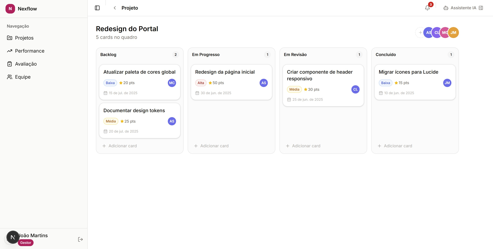

# Nexflow

A project management concept that puts the task board and performance in the same place. People move cards on a Kanban board, managers review finished cards and give points, and an AI assistant explains how the score works.

**Live demo: [nexflow-plum.vercel.app](https://nexflow-plum.vercel.app)** (add `#admin` to any URL to see the manager view)



## What's in it

- **Kanban per project**, with drag and drop between columns, priority and points on each card.
- **Two roles.** A collaborator sees their projects and their own performance. A manager also gets an evaluation screen to approve finished cards and give points.
- **Performance and achievements.** A score bar against a target, the latest deliveries and badges for milestones.
- **AI assistant panel.** A side chat with suggested questions for each role, such as "How do I improve my score?". The answers are mocked.
- **Team page** with filters, plus notifications.

## How it was built

Front end only: every piece of data comes from static mock files, so the demo works without a backend. Before coding, I mapped the features on a value and effort matrix and built the high value, low effort ones first. The planning docs are in `docs/planning`.

## Stack

Next.js (App Router), React, TypeScript, Tailwind CSS and shadcn/ui.

## Running locally

```bash
npm install
npm run dev
```

Then open http://localhost:3000.
